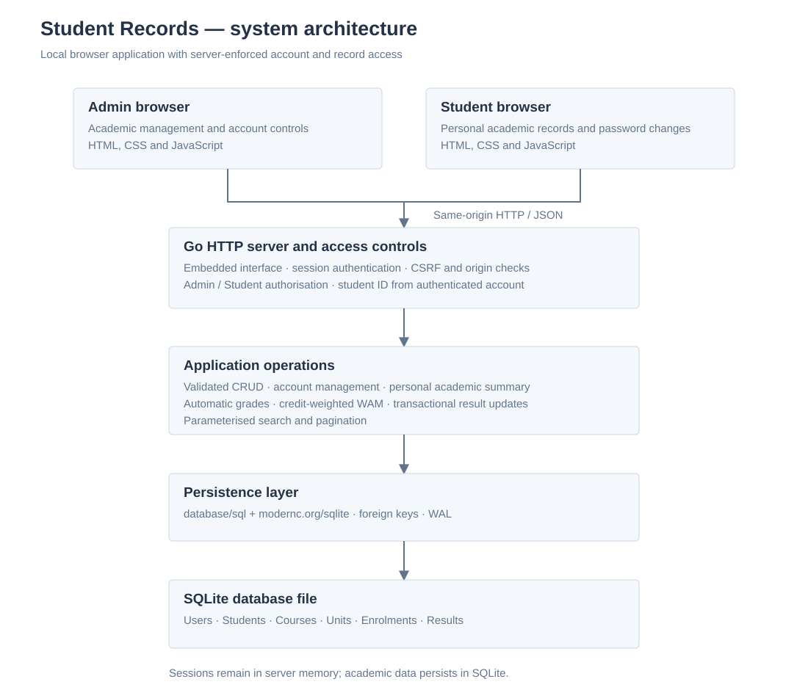
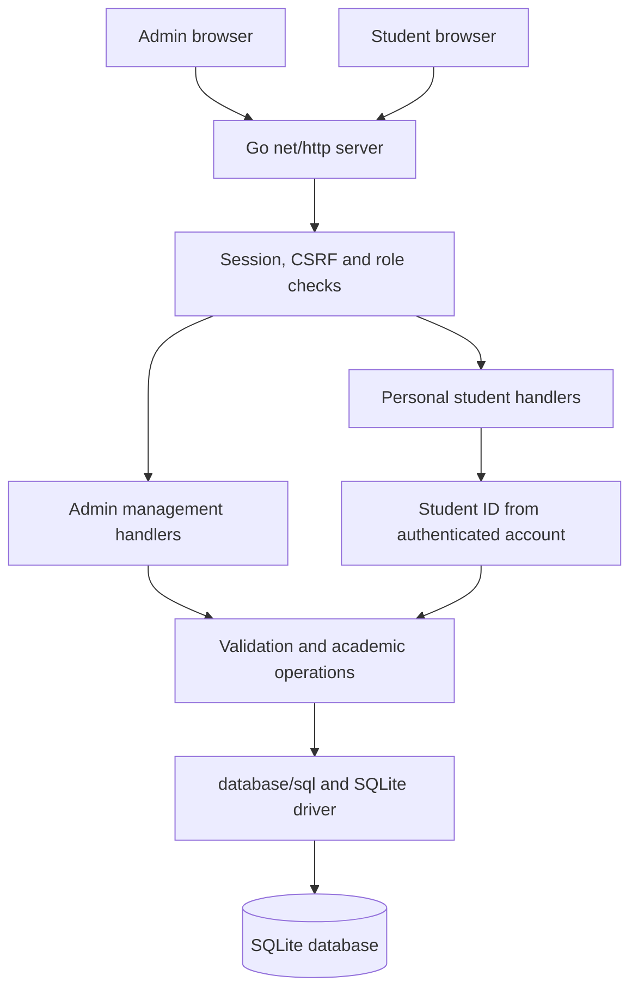
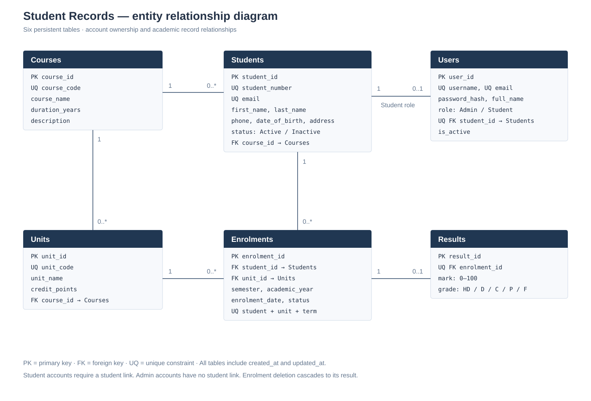
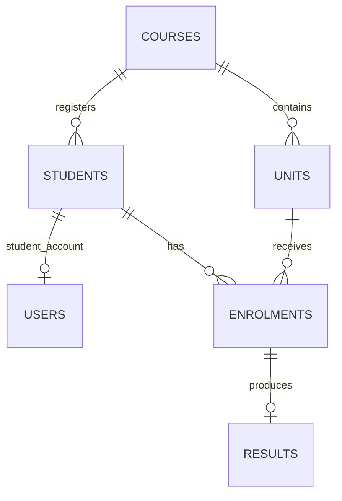

# Architecture and data model

## System architecture





The server embeds the interface and schema with `embed.FS`. The browser sends JSON requests using Fetch. Authentication uses an HttpOnly, SameSite=Strict cookie; cookies use Secure when the request reaches the server over TLS. The server issues a session-bound CSRF token, required on authenticated writes, and checks request origins. Content Security Policy restricts scripts and styles to local assets.

PBKDF2-HMAC-SHA256 hashes use 600,000 iterations, a random 16-byte salt and a 32-byte key. Comparison uses `crypto/subtle`. Passwords and hashes are omitted from API responses. Sessions expire after eight hours, are stored in memory, and are invalidated by password changes, account edits and logout. Disabled accounts are rejected on each request. Login attempts are limited per remote IP over a ten-minute window.

`net/http` can serve independent requests concurrently. A mutex protects session/rate-limit maps. A Store mutex serializes authentication changes and academic writes across validation and persistence, preventing conflicting writes from passing checks simultaneously. SQLite uses one open connection with foreign keys enabled, WAL journaling and a busy timeout. Result insertion/update and enrolment completion are one transaction; result deletion and enrolment reopening are another transaction.

## Student isolation

`GET /api/student/overview` derives `student_id` from the authenticated account loaded by the server. It rejects query parameters and accepts no browser-selected student identity. SQL selects only this student's profile and academic records. Administrative list, detail and lookup endpoints all require Admin. The frontend does not fetch other students' records and then hide them.

## Access matrix

| Endpoint | Method | Access |
| --- | --- | --- |
| `/api/login` | POST | Public; credential verification and throttling |
| `/api/me` | GET | Authenticated account and CSRF token |
| `/api/logout` | POST | Authenticated; CSRF required |
| `/api/password` | POST | Authenticated; current password and CSRF required |
| `/api/student/overview` | GET | Student; only own academic record |
| `/api/dashboard` | GET | Admin |
| `/api/lookups` | GET | Admin; relationship options for management forms |
| `/api/students`, `/api/courses`, `/api/units`, `/api/enrolments`, `/api/results`, `/api/users` | GET, POST | Admin; list or create |
| `/api/{resource}/{id}` | GET, PUT, DELETE | Admin; read, update or delete |
| `/api/students/{id}/summary` | GET | Admin |

Admin list responses contain `items`, `total`, `page` and `page_size`. Search uses `q`; the maximum page size is 100. Resource-specific filters include status, course, student, semester, year, grade and account state. SQL identifiers are allowlisted and values are parameterized.

## ER diagram





The Users relationship above applies to accounts whose role is Student. Admin accounts have no student link. A student can exist before an account is created.

| Table | Key and relationships | Principal constraints |
| --- | --- | --- |
| Users | `user_id` PK; `student_id` unique FK to Students | Only Admin/Student roles; Student must have a student ID; Admin must not; unique username/email; account state is 0 or 1 |
| Students | `student_id` PK; `course_id` FK | Unique student number/email; Active/Inactive status |
| Courses | `course_id` PK | Unique course code; duration 1–10 years |
| Units | `unit_id` PK; `course_id` FK | Unique unit code; credit points 1–100 |
| Enrolments | `enrolment_id` PK; student and unit FKs | Unique student/unit/year/semester; supported status values; year 2000–2100; semester 1–3 |
| Results | `result_id` PK; unique `enrolment_id` FK | At most one result per enrolment; mark 0–100; allowed grade values |

Foreign keys restrict deletion of referenced courses, students and units. A student with a linked account cannot be deleted until the account is removed. Deleting an enrolment cascades to its result. Every table includes created/updated timestamps.

## Result entry sequence

```mermaid
sequenceDiagram
    participant B as Admin browser
    participant A as Go API
    participant D as SQLite
    B->>A: POST /api/results with enrolment ID, mark and CSRF
    A->>A: Authenticate Admin and validate fields
    A->>D: Check enrolment exists and is not withdrawn
    A->>A: Calculate grade from mark
    A->>D: BEGIN; insert result; complete enrolment; COMMIT
    A-->>B: Saved result ID
    B->>A: GET student academic summary
    A->>D: Aggregate marks multiplied by unit credits
    A-->>B: History, WAM and earned credits
```

## Boundaries and report notes

The final Assignment 2 implementation adds `academicReader` and typed `StudentProfile`, `AcademicUnit` and `AcademicSummary` values in `summary.go`. `Store.AcademicSummary` accepts the HTTP request context, uses a single read transaction, and computes counts and WAM from the returned unit slice. Pointer-valued marks, result IDs and grades preserve database nulls. Both Admin and Student summary handlers use this contract. The final Go struct diagram is `Go_Struct_Diagram.svg`; report diagrams with larger labels are `Report_Architecture.svg` and `Report_ER_Diagram.svg`.

- All Go files remain in `package main`, preserving the small project's understandable structure. File separation organizes responsibilities; it is not package-level access isolation.
- Go structs and methods represent Store, App, accounts and sessions. `http.Handler` demonstrates interface use, and errors are explicitly returned and checked.
- Browser form and navigation events are JavaScript events. They cause HTTP requests handled by Go; they are not a Go GUI event framework.
- WAM is derived from saved enrolments, results and current unit credits rather than stored as a mutable student field.
- The design supports one course per student and one course per unit. Transfers with historical enrolments, shared elective units, institutional repeat-unit policies and student self-enrolment are outside this implementation.
- The Admin account editor is separate from student profile editing. Account display name/email are account metadata and are not automatically synchronized after a student profile edit.
- The application is a local deployment. Its in-memory sessions, current-credit WAM model and lack of institutional audit/recovery services should be described accurately in the technical report.
